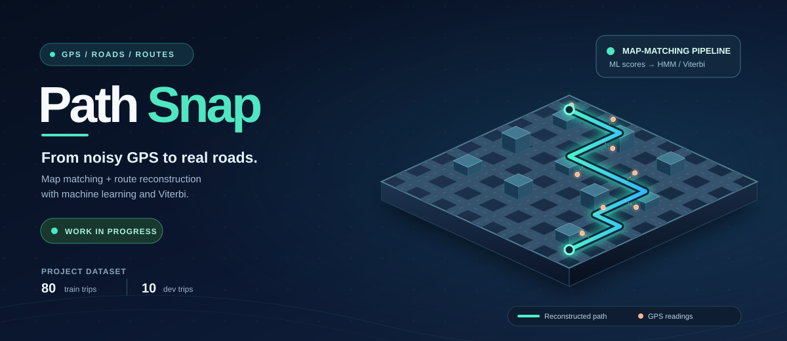
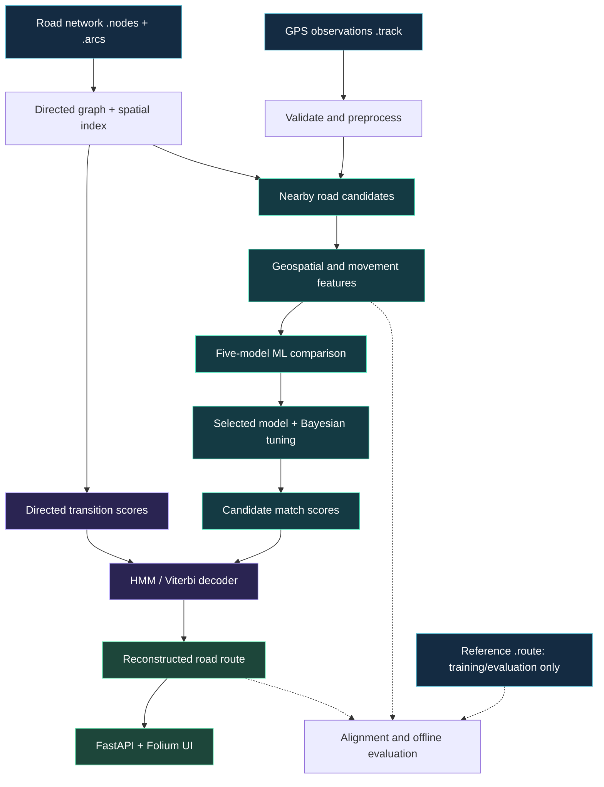

<div align="center">



# 🛰️ PathSnap

### Distributed Map-Matching & Route Reconstruction

**Turning noisy GPS observations into plausible, connected road routes.**


*Temporary project landing page · Implementation and evaluation in progress*

</div>

---

## ✨ What is PathSnap?

GPS coordinates are not always accurate. A vehicle can appear to be driving **beside** a road, on a parallel street, or even through a building. PathSnap aims to match those noisy observations to the most likely **directed road segments** and reconstruct a route that makes sense over time.

The project combines **candidate road search**, **feature engineering**, **supervised machine learning**, and **HMM/Viterbi sequence decoding**. The final system is planned to expose predictions through an API and display them on an interactive map.

## 🧭 System architecture



> **Important:** Reference routes are used only for permitted training and offline evaluation. They must not be fed into the prediction pipeline or exposed in the evaluator UI.

## 🗂️ Dataset at a glance

| Partition | Trips | Purpose |
|:--|--:|:--|
| Training | **80** | Train models and run trip-grouped cross-validation |
| Student testing | **10** | Development-stage evaluation |
| Reserved evaluator testing | **10** | Final evaluation; **not included in the currently supplied data** |

Each trip uses the following files:

| File | Contents |
|:--|:--|
| `.track` | GPS longitude, latitude, timestamp |
| `.nodes` | Road-network node coordinates |
| `.arcs` | Directed edges between road-network nodes |
| `.route` | Ordered reference arc sequence, where provided |

**Important modelling detail:** A `.route` file does **not** provide one label for every GPS row. Reference-route alignment must be handled explicitly. Road arc IDs are also **trip-local**, not shared global classes.

## 🧠 Planned machine-learning experiments

We plan to compare five candidate-road classifiers from distinct algorithm families:

| Model | Family | Role |
|:--|:--|:--|
| Logistic Regression | Linear / probabilistic | Interpretable baseline |
| K-Nearest Neighbours | Instance-based | Similarity-based benchmark |
| Random Forest | Ensemble | Robust nonlinear benchmark |
| LightGBM | Gradient boosting | Efficient tabular candidate scorer |
| Multilayer Perceptron | Neural network | Learned nonlinear relationships |

The final model will be chosen **only after real experiments**. The decoder will then use model scores together with road-network transitions to reconstruct a coherent route.

## 👥 Team workstreams

| Member | Responsibility |
|:--|:--|
| **Vrinda** | Data loading, EDA, directed graph, candidate generation |
| **Saketh** | Reference alignment, features, five-model comparison |
| **Vivek** | Bayesian optimisation, HMM, Viterbi, route evaluation |
| **Vismaya** | FastAPI, Folium UI, integration, two-laptop demonstration |

## 🧩 Planned technology stack

`Python` · `NumPy` · `pandas` · `scikit-learn` · `LightGBM` · `Optuna` · `NetworkX` · `Shapely` · `FastAPI` · `Folium` · `pytest`

The exact dependency list may change as the team integrates its modules.

### Getting started

```bash
git clone https://github.com/SakethPractice/ML-Hackathon.git
cd ML-Hackathon
```

Install and run the feature workflow:

```bash
python -m pip install -e .
python scripts/run_feature_analysis.py
python scripts/run_feature_selection.py
python scripts/run_feature_validation.py
python -m pytest tests/ -v
```

The workflow uses only `data/processed/train` for feature selection and
cross-validation. Student-testing trips are not used to select features.
Five-fold `GroupKFold` keeps every candidate row from a trip in the same fold.
The generated outputs are written to `results/` and `results/figures/`;
the reproducible selected subset is in `results/selected_features.json`.

### Prediction API

`POST /predict` loads the selected model recorded in
`artifacts/models/experiment_metadata.json`, prepares the requested raw
evaluator trip with `with_labels=False`, extracts the same 15 features used in
training, and scores each `(observation_id, arc_id)` candidate. The resulting
`match_probability` values are adapted to the decoder's
`(observation_idx, arc_id, match_probability)` input and passed to
`decode_trip`. The API returns the decoder's `TripDecodeResult` schema.
Reference `.route` files are not opened for prediction.

The inference adapter is `pathsnap.api.inference.TrainedModelPredictor`.
Its callable interface is `predictor(trip_id: str) -> TripDecodeResult`;
`TrainedModelPredictor.from_artifacts(data_root, partition)` loads the selected
artifact and API configuration. Run the server from the repository root:

```powershell
$env:PYTHONPATH = "src"
python -m uvicorn pathsnap.api.main:app --host 0.0.0.0 --port 8000
```

`GET /trips` lists available evaluator IDs. `POST /predict` takes
`{"trip_id":"00000067"}` and responds with the `TripDecodeResult` fields:
`trip_id`, `status`, `observation_indices`, `matched_arc_ids`,
`observation_status`, `expanded_route_arc_ids`, `route_segments`,
`route_geometry`, `gap_boundaries`, `diagnostics`, and `runtime_seconds`.


---

<div align="center">

**PathSnap** · *Find the road behind the GPS noise.*

<sub>Machine Learning project</sub>

</div>
